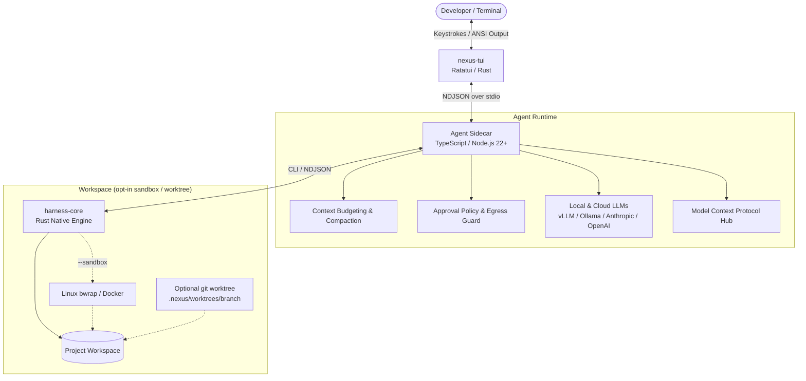

# Nexus Code

[](https://github.com/mikeholownych/nexus-code/releases)
[](https://github.com/mikeholownych/nexus-code/actions)
[](LICENSE)
[](docs/DEVELOPMENT.md#release-package)
[](https://nodejs.org/)
[](https://www.rust-lang.org/)

**Nexus Code** is an open-source, local-first AI coding agent and execution harness. It pairs a TypeScript agent and sidecar with native Rust workspace tools and a Ratatui terminal user interface (TUI), with opt-in sandboxing, human approval modes, and Git worktree isolation.

> **Status:** the latest stable release is [v1.1.3](https://github.com/mikeholownych/nexus-code/releases). v1.1.4 is in development: its work ledger is closed and qualification is pending. Development plans and this README do not establish release readiness; see [GitHub Releases](https://github.com/mikeholownych/nexus-code/releases) and [`docs/releases/`](docs/releases/).
>
> The Cloudflare contest entry is historical: see [docs/CLOUDFLARE_CONTEST.md](docs/CLOUDFLARE_CONTEST.md).

---

## Table of Contents

- [Why Nexus Code?](#why-nexus-code)
- [Architecture Overview](#architecture-overview)
- [Quick Start](#quick-start)
  - [Installation](#1-installation)
  - [Inference Setup](#2-inference-setup)
  - [First Run](#3-first-run)
- [Execution Modes & Workflows](#execution-modes--workflows)
  - [Interactive TUI](#interactive-terminal-ui)
  - [Command-Line REPL](#command-line-repl)
  - [Autonomous Non-Interactive Run](#autonomous-task-execution)
- [Core Capabilities](#core-capabilities)
  - [Security & Sandboxing](#defense-in-depth-sandboxing)
  - [Git Worktree Isolation](#git-worktree-isolation)
  - [Human-in-the-Loop Controls](#human-in-the-loop-hitl-approvals)
  - [Context Budgeting & Cost Governance](#context-budgeting--cost-governance)
  - [Universal Model Ecosystem & MCP](#universal-model-support--mcp)
- [Common Commands & Slash Actions](#common-commands--slash-actions)
- [Building from Source](#building-from-source)
- [Repository Structure](#repository-structure)
- [Documentation Index](#documentation-index)
- [Contributing & Community](#contributing--community)
- [License](#license)

---

## Why Nexus Code?

Nexus Code's design choices:

- **Approval by Default:** Unset permission mode is `review`: file writes, shell commands, and network egress need your confirmation. File tools are confined to the workspace, and `--sandbox` adds Linux Bubblewrap (`bwrap`) or Docker isolation for commands (see the [architecture reference](docs/ARCHITECTURE.md) for limits).
- **Opt-in Git Worktree Isolation:** Pass `--worktree` (ephemeral) or `--worktree-branch <name>` (named, kept) and the run happens in a lightweight Git worktree under `.nexus/worktrees/` instead of your active checkout; without either flag it runs in your checkout. See [docs/WORKTREES.md](docs/WORKTREES.md).
- **Terminal UI:** Built on [Ratatui](https://ratatui.rs/), the live interface streams tokens, takes keyboard approvals, and offers diff review.
- **Verification before merge:** `nexus worktree merge` requires a recorded passing verification for the exact state being merged, unless you pass `--no-verify-receipt --reason`.
- **Cost & Context Protection:** Token tracking, context compaction, and optional cloud limits (`NEXUS_CLOUD_MAX_COST_USD`; only enforceable when the provider reports cost).

---

## Architecture Overview

Nexus Code uses a hybrid, decoupled architecture:
1. **Front-End & Terminal Experience (`core/src/bin/nexus_tui`):** Rust binary using Ratatui and crossterm for diff rendering, event handling, and terminal management.
2. **Agent Brain & Sidecar (`cli/`):** TypeScript-driven execution loop handling turn dispatch, LLM conversation state, tool calling, Model Context Protocol (MCP), and context compaction.
3. **Workspace Tools Engine (`core/src/` / `harness-core`):** Rust tools implementing file operations, unified diff generation, symbol parsing, and command execution.



---

## Quick Start

### 1. Installation

On Linux x86-64 (glibc 2.35+ and Node.js 22+):

```sh
curl -fsSL https://raw.githubusercontent.com/mikeholownych/nexus-code/main/install.sh | sh
```

The installer verifies SHA-256 checksums, installs the client package into `~/.local/lib/nexus`, and creates a symlink at `~/.local/bin/nexus`. Ensure `~/.local/bin` is in your `PATH`:

```sh
export PATH="$HOME/.local/bin:$PATH"
```

> [!NOTE]
> To pin a release or install a prerelease, set `NEXUS_VERSION` to a tag from [GitHub Releases](https://github.com/mikeholownych/nexus-code/releases):
> ```sh
> curl -fsSL https://raw.githubusercontent.com/mikeholownych/nexus-code/main/install.sh | NEXUS_VERSION=v1.1.3 sh
> ```

### 2. Inference Setup

Nexus Code connects to any OpenAI-compatible local server (e.g. Ollama, llama.cpp, vLLM, LM Studio) or cloud provider.

Configure your endpoint in `~/.config/nexus/config.env`:

```sh
mkdir -p "$HOME/.config/nexus"
chmod 700 "$HOME/.config/nexus"
cat > "$HOME/.config/nexus/config.env" <<'EOF'
LOCAL_LLM_ENDPOINT=http://localhost:1234/v1
LOCAL_LLM_MODEL=qwen2.5-coder-7b-instruct
LOCAL_LLM_API_KEY=local
EOF
chmod 600 "$HOME/.config/nexus/config.env"
```

For cloud providers (Anthropic Claude or OpenAI), see [Cloud Providers Guide](docs/CLOUD_PROVIDERS.md).

### 3. First Run

Navigate to any git repository and start Nexus Code:

```sh
cd /path/to/your/project
nexus
```

---

## Execution Modes & Workflows

### Interactive Terminal UI
Running `nexus` in a standard terminal launches the full-screen interactive TUI:
```sh
nexus
```
- Real-time token streaming and syntax highlighting.
- Visual approval prompt for shell execution and file modification.
- Multi-line composer and bracketed paste handling.
- Use `/help` for available slash commands, `/model` to switch providers, or `Esc` to cancel the active turn.

### Command-Line REPL
For terminal multiplexers, remote SSH sessions, or plain terminal workflows:
```sh
nexus repl
```
Provides the full conversational agent with line-based interactive approval prompts.

### Autonomous Task Execution
Execute a targeted objective without the interactive UI and exit when the run finishes:
```sh
nexus run "Add unit tests for the token bucket rate limiter in src/rate_limiter.ts"
```
Approval prompts still apply unless you choose `--mode auto` or `--yes`; see the [User Manual](docs/USER_MANUAL.md). Add `--worktree-branch <name>` to run inside a named worktree that is kept after the run.

---

## Core Capabilities

### Defense-in-Depth Sandboxing
- **Workspace path jail:** the Rust file tools reject paths outside the workspace, including `..` and symlink escapes.
- **Opt-in command sandbox:** `--sandbox` runs commands under Bubblewrap (`bwrap`) or Docker. Without it, host commands have your filesystem access; `--read-only` masks `$HOME` when `bwrap` is available.
- **Egress approval:** network access asks on first use of each origin, except under `--yes`.

[`docs/ARCHITECTURE.md`](docs/ARCHITECTURE.md) lists each guarantee and its limits.

### Git Worktree Isolation
Eliminate uncommitted workspace pollution with native named worktrees (see [docs/WORKTREES.md](docs/WORKTREES.md)):
- Run speculative features under `.nexus/worktrees/<branch>` (or configured sibling directories) without touching your checked-out files.
- `nexus worktree switch -c <branch>` (or session `/worktree switch -c <branch>`) creates an isolated branch checkout; `nexus run --worktree-branch <branch> "<task>"` runs a task inside one.
- `nexus worktree merge` squashes, rebases, and fast-forwards the branch into the default branch, then removes the worktree. It needs a recorded passing verification (or `--no-verify-receipt --reason`); `--ai-message` drafts the commit message with your configured model.
- `nexus worktree prune` removes worktrees already integrated into the default branch (`--dry-run` first), `nexus worktree remove <branch>` removes one, and `nexus worktree list --json` inspects them.

### Human-in-the-Loop (HITL) Approvals
Stay in complete control of changes:
- **`review` mode (default):** Prompts for confirmation before file writes, shell commands, or network calls. `--yes` bypasses all prompts.
- **`auto` mode (`--mode auto`):** Writes and commands run without approval; network egress still asks on first use of each origin.
- **`read-only` mode (`--read-only`):** Explores code without permitting modifications or non-read commands.

### Context Budgeting & Cost Governance
- Tracks token use against the model's context limit.
- Compacts older conversation turns when context headroom shrinks.
- Optional cloud ceilings via `NEXUS_CLOUD_MAX_REQUESTS`, `NEXUS_CLOUD_MAX_TOKENS` and `NEXUS_CLOUD_MAX_COST_USD`.

### Universal Model Support & MCP
- Local inference: native support for llama.cpp, Ollama, and vLLM (see [docs/LOCAL_SERVERS.md](docs/LOCAL_SERVERS.md)).
- Cloud provider support with secret redaction and configurable cost governance (see [docs/CLOUD_PROVIDERS.md](docs/CLOUD_PROVIDERS.md)).
- MCP client: connect external MCP servers (`.mcp.json` or `~/.config/nexus/mcp.json`) to expose their tools; see [docs/MCP_GUIDE.md](docs/MCP_GUIDE.md).

---

## Common Commands & Slash Actions

| Command | Shortcut | Description |
|---|---|---|
| `/help` | `/?` | List the slash commands and keybindings |
| `/model` | — | Choose a model from any connected provider (press Ctrl+P inside the picker to connect one) |
| `/status` | — | Show workspace, model, mode, endpoint, and session info |
| `/worktree` | — | Manage the speculative worktree and named worktrees (`status`, `discard`, `list`, `path`, `switch`, `remove`, `copy-ignored`, `prune`, `merge`) |
| `/diff` | — | Show uncommitted changes as a syntax-highlighted unified diff |
| `/commit` | — | Commit changes; suggests a conventional commit message if omitted |
| `/doctor` | — | Diagnose configuration, endpoint, engine, shell, and session state |
| `/tokens` | — | Display context window use and session token totals |
| `/receipt` | — | Show turn outcome, verifier evidence, and validation receipt |
| `/clear` | — | Reset conversation context for a clean task turn |
| `/exit` | `Ctrl+C` | Quit (`Ctrl+C` cancels a running turn, twice to quit; quits when idle and empty) |

---

## Building from Source

### Prerequisites
- **Linux x86-64** with glibc 2.35+
- **Node.js** 22.0.0 or higher & `npm`
- **Rust** 2024 edition (MSRV 1.85.0+, pinned toolchain 1.95.0 in `rust-toolchain.toml`) & `cargo`
- **C compiler & linker** (`gcc` or `clang`), `make`, `pkg-config`

### Build Steps

```sh
# 1. Clone repository
git clone https://github.com/mikeholownych/nexus-code.git
cd nexus-code

# 2. Install CLI dependencies
npm ci --prefix cli

# 3. Build native Rust binaries and TypeScript distribution
make build

# 4. Run test suites
make test
```

For running comprehensive CI tests locally (including bubblewrap isolation fixtures):
```sh
sudo make test-ci
```

---

## Repository Structure

```
nexus-code/
├── cli/                   # TypeScript agent brain, REPL, slash router, and sidecar
│   ├── src/               # Agent loops, sandbox adapters, tokens, and git integrations
│   └── test/              # Integration and unit tests
├── core/                  # Rust workspace tools and Ratatui terminal UI
│   ├── src/bin/nexus_tui/ # Live TUI: views, diff cards, composer, markdown
│   └── src/               # File operations, sandboxing, unified diffs, syntax
├── docs/                  # Architecture specs, user manuals, and provider guides
├── experiments/           # Experiment and measurement records, including the Cloudflare Artifacts vertical slice
├── scripts/               # Release packaging, CI runners, and security gates
└── tasks/                 # Working notes: plan and lessons
```

---

## Documentation Index

Explore our comprehensive guides in the [`docs/`](docs/) directory:

- **[User Manual](docs/USER_MANUAL.md):** Complete guide to interactive workflows, approval postures, and session management.
- **[Quickstart Guide](quickstart.md):** Installation, configuration, and running your first task.
- **[Architecture Reference](docs/ARCHITECTURE.md):** Deep dive into the process model, security guarantees, and execution loop.
- **[Worktree Operations](docs/WORKTREES.md):** Guide to isolated branching, receipt gates, and receipt-gated merges.
- **[Local Servers Guide](docs/LOCAL_SERVERS.md):** Instructions for configuring Ollama, LM Studio, vLLM, and llama.cpp.
- **[Cloud Providers Guide](docs/CLOUD_PROVIDERS.md):** Setup for Anthropic, OpenAI, custom endpoints, and secret redaction.
- **[Developer & Release Guide](docs/DEVELOPMENT.md):** Contributing, local test gates, reproducible builds, and releases.
- **[Doctor & Troubleshooting](docs/DOCTOR_TROUBLESHOOTING.md):** Diagnosing common environment, sandbox, and provider issues.

---

## Contributing & Community

Contributions are welcome:

- **Contribution Guidelines:** Read [CONTRIBUTING.md](CONTRIBUTING.md) before submitting pull requests.
- **Code of Conduct:** We expect all participants to uphold our community standards outlined in [CODE_OF_CONDUCT.md](CODE_OF_CONDUCT.md).
- **Security Disclosures:** For vulnerability reporting, consult [SECURITY.md](SECURITY.md).
- **Governance:** Project governance and maintainer policies are documented in [GOVERNANCE.md](GOVERNANCE.md).
- **Support Channels:** Find help or join discussions via [SUPPORT.md](SUPPORT.md) and [GitHub Discussions](https://github.com/mikeholownych/nexus-code/discussions).

---

## License

Nexus Code is dual-licensed open-source software:
- The TypeScript agent, CLI, and sidecar (`cli/`) and root repository files are licensed under the **[MIT License](LICENSE)**.
- The Rust workspace tools and native terminal UI (`core/`) are licensed under the **[Apache-2.0 License](https://www.apache.org/licenses/LICENSE-2.0)** (see `core/Cargo.toml`).
