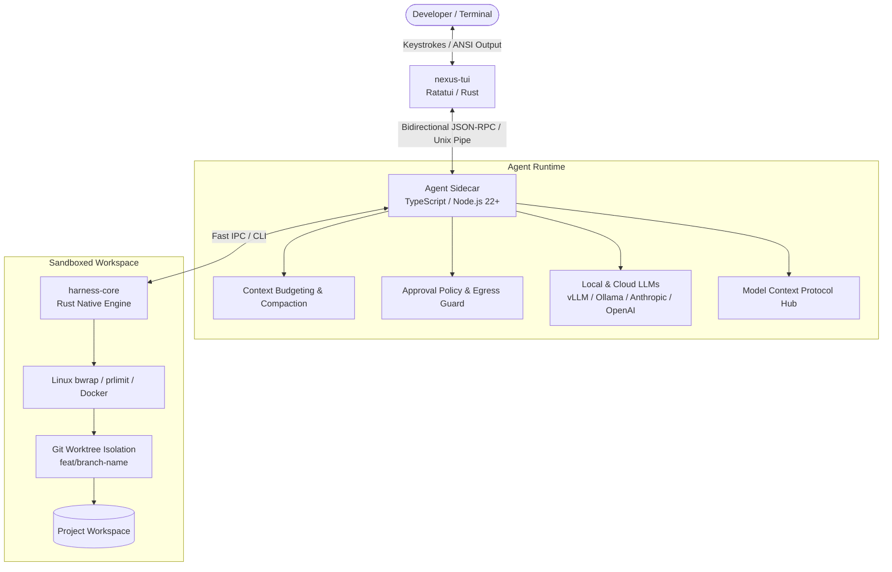

# Nexus Code

[](https://github.com/mikeholownych/nexus-code/releases)
[](https://github.com/mikeholownych/nexus-code/actions)
[](LICENSE)
[](docs/DEVELOPMENT.md#release-package)
[](https://nodejs.org/)
[](https://www.rust-lang.org/)

**Nexus Code** is an open-source, local-first AI coding agent and execution harness. Designed for developers who demand high performance, rigorous security sandboxing, transparent human-in-the-loop control, and seamless Git worktree isolation, Nexus Code pairs a high-level TypeScript agent with native Rust workspace tooling and a rich Ratatui terminal user interface (TUI).

---

## Table of Contents

- [Why Nexus Code?](#why-nexus-code)
- [Architecture Overview](#architecture-overview)
- [Quick Start](#quick-start)
  - [Installation](#1-installation)
  - [Inference Setup](#2-inference-setup)
  - [First Run](#3-first-run)
- [Execution Modes & Workflows](#execution-modes--workflows)
  - [Interactive TUI](#interactive-terminal-ui)
  - [Command-Line REPL](#command-line-repl)
  - [Autonomous Non-Interactive Run](#autonomous-task-execution)
- [Core Capabilities](#core-capabilities)
  - [Security & Sandboxing](#-defense-in-depth-sandboxing)
  - [Git Worktree Isolation](#-git-worktree-isolation)
  - [Human-in-the-Loop Controls](#-human-in-the-loop-hitl-approvals)
  - [Context Budgeting & Cost Governance](#-context-budgeting--cost-governance)
  - [Universal Model Ecosystem & MCP](#-universal-model-support--mcp)
- [Common Commands & Slash Actions](#common-commands--slash-actions)
- [Building from Source](#building-from-source)
- [Repository Structure](#repository-structure)
- [Documentation Index](#documentation-index)
- [Contributing & Community](#contributing--community)
- [License](#license)

---

## Why Nexus Code?

Most agentic coding tools operate either as black-box cloud subscriptions or as unconstrained local scripts with unrestricted shell access. Nexus Code takes a systems-engineering approach:

- **Security by Default:** All agent actions (filesystem writes, command executions, child processes) run within unprivileged Linux Bubblewrap (`bwrap`) sandboxes and strict kernel resource limits (`prlimit`), with optional Docker container isolation.
- **Git Worktree Isolation:** Rather than mutating your active checkout, speculative code changes and verification loops occur in dedicated, lightweight Git worktrees (`.nexus/worktrees/`), complete with verification receipts and clean fast-forward squashes.
- **Thoughtfully Designed TUI:** Built on [Ratatui](https://ratatui.rs/), the live terminal interface delivers smooth token streaming, instant keyboard approvals, unified diff review, proportional modal overlays, and resilient paste management.
- **Deterministic Verification:** Nexus Code refuses to guess whether code works. It establishes verifiable test baselines before modification and requires deliverable-bound verifier checks before merging.
- **Cost & Context Protection:** Real-time token capacity tracking, automatic context compaction, and hard budget limits (`NEXUS_CLOUD_MAX_COST_USD`) prevent runaway API spending.

---

## Architecture Overview

Nexus Code uses a hybrid, decoupled architecture:
1. **Front-End & Terminal Experience (`core/src/bin/nexus_tui`):** High-performance Rust binary utilizing Ratatui and crossterm for zero-flicker diff rendering, event handling, and terminal management.
2. **Agent Brain & Sidecar (`cli/`):** TypeScript-driven execution loop handling turn dispatch, LLM conversation state, tool calling, Model Context Protocol (MCP), and context compaction.
3. **Workspace Tools Engine (`core/src/` / `harness-core`):** Rust native library implementing high-throughput file operations, unified diff generation, syntax inspection, and sandboxed command execution.



---

## Quick Start

### 1. Installation

On Linux x86-64 (glibc 2.35+ and Node.js 22+):

```sh
curl -fsSL https://raw.githubusercontent.com/mikeholownych/nexus-code/main/install.sh | sh
```

The installer verifies SHA-256 checksums, installs the client package into `~/.local/lib/nexus`, and creates a symlink at `~/.local/bin/nexus`. Ensure `~/.local/bin` is in your `PATH`:

```sh
export PATH="$HOME/.local/bin:$PATH"
```

> [!NOTE]
> To pin a specific release version, set `NEXUS_VERSION`:
> ```sh
> curl -fsSL https://raw.githubusercontent.com/mikeholownych/nexus-code/main/install.sh | NEXUS_VERSION=v1.1.4 sh
> ```

### 2. Inference Setup

Nexus Code connects to any OpenAI-compatible local server (e.g. Ollama, llama.cpp, vLLM, LM Studio) or cloud provider.

Configure your endpoint in `~/.config/nexus/config.env`:

```sh
mkdir -p "$HOME/.config/nexus"
chmod 700 "$HOME/.config/nexus"
cat > "$HOME/.config/nexus/config.env" <<'EOF'
LOCAL_LLM_ENDPOINT=http://localhost:1234/v1
LOCAL_LLM_MODEL=qwen2.5-coder-7b-instruct
LOCAL_LLM_API_KEY=local
EOF
chmod 600 "$HOME/.config/nexus/config.env"
```

For cloud providers (Anthropic Claude or OpenAI), see [Cloud Providers Guide](docs/CLOUD_PROVIDERS.md).

### 3. First Run

Navigate to any git repository and start Nexus Code:

```sh
cd /path/to/your/project
nexus
```

---

## Execution Modes & Workflows

### Interactive Terminal UI
Running `nexus` in a standard terminal launches the full-screen interactive TUI:
```sh
nexus
```
- Real-time token streaming and syntax highlighting.
- Visual approval prompt for shell execution and file modification.
- Multi-line composer with history search and bracketed paste handling.
- Use `/help` for available slash commands, `/model` to switch providers, or `Esc` to cancel the active turn.

### Command-Line REPL
For terminal multiplexers, remote SSH sessions, or plain terminal workflows:
```sh
nexus repl
```
Provides the full conversational agent with line-based interactive approval prompts.

### Autonomous Task Execution
Execute a targeted objective headlessly and exit upon verified completion:
```sh
nexus run "Add unit tests for the token bucket rate limiter in src/rate_limiter.ts"
```
Nexus will explore the codebase, plan edits, execute tests inside the sandbox, verify outcomes against your deliverable baseline, and record an audit trail.

---

## Core Capabilities

### 🛡️ Defense-in-Depth Sandboxing
Every command executed by the agent runs in an isolated sandbox:
- **Bubblewrap (`bwrap`) Isolation:** Mounts the root filesystem read-only, providing dedicated writable mounts only for the workspace.
- **Process Resource Limits (`prlimit`):** Caps CPU time, memory consumption (AS/RSS), max open file descriptors, and total process count.
- **Network Egress Guard:** Unauthorized network calls from within the sandbox are blocked unless explicitly permitted by policy.

### 🌲 Git Worktree Isolation
Eliminate uncommitted workspace pollution with native worktree branches:
- Run speculative features in `.nexus/worktrees/<branch>` with zero risk to your checked-out files.
- Command `/worktree switch -c feat/auth` creates an isolated checkout with selected cached dependencies.
- `/worktree merge` fast-forwards verified work with automated verification receipts and amend squash messages.

### 🤝 Human-in-the-Loop (HITL) Approvals
Stay in complete control of changes:
- **`review` mode (default):** Prompts for confirmation before executing file writes, shell invocations, or network calls.
- **`auto` mode:** Autonomous file edits and test runs; asks for approval only on first-time egress to new network endpoints.
- **`read-only` mode:** Strictly forbids write operations and mutative commands; safe for auditing untrusted codebases.

### 🧠 Context Budgeting & Cost Governance
- Tracks token consumption per step against discovered model context limits.
- Automatic compaction summarizes older conversation turns when context headroom shrinks.
- Enforces strict cloud cost ceilings via `NEXUS_CLOUD_MAX_COST_USD`.

### 🔌 Universal Model Support & MCP
- Compatible with all standard local engines: llama.cpp, Ollama, vLLM, LM Studio, and Jan.
- Direct cloud API support: Anthropic Claude 3.5 Sonnet / Haiku, OpenAI GPT-4o / o1.
- Full support for Model Context Protocol (MCP) clients and servers to expose external tools and database access.

---

## Common Commands & Slash Actions

| Command | Shortcut | Description |
|---|---|---|
| `/help` | `?` | Displays available slash commands and keyboard shortcuts |
| `/model` | `Ctrl+P` | Opens the model picker and provider connection dialog |
| `/worktree` | — | Manages isolated git worktree branches (`list`, `switch`, `merge`, `prune`) |
| `/diff` | — | Inspects pending and uncommitted workspace changes |
| `/commit` | — | Generates an AI commit message and stages changes |
| `/status` | — | Shows active workspace, branch, model, and approval posture |
| `/tokens` | — | Displays current context window consumption and headroom |
| `/receipt` | — | Inspects verification receipts for the last completed turn |
| `/clear` | `Ctrl+L` | Resets conversation history for a fresh task turn |
| `/exit` | `Ctrl+C` | Restores terminal screen and prints session resume command |

---

## Building from Source

### Prerequisites
- **Linux x86-64** with glibc 2.35+
- **Node.js** 22.0.0 or higher & `npm`
- **Rust** 1.80+ & `cargo`
- **C compiler & linker** (`gcc` or `clang`), `make`, `pkg-config`

### Build Steps

```sh
# 1. Clone repository
git clone https://github.com/mikeholownych/nexus-code.git
cd nexus-code

# 2. Install CLI dependencies
npm ci --prefix cli

# 3. Build native Rust binaries and TypeScript distribution
make build

# 4. Run test suites
make test
```

For running comprehensive CI tests locally (including bubblewrap isolation fixtures):
```sh
sudo make test-ci
```

---

## Repository Structure

```
nexus-code/
├── cli/                   # TypeScript agent brain, REPL, slash router, and sidecar
│   ├── src/               # Agent loops, sandbox adapters, tokens, and git integrations
│   └── test/              # Integration and unit tests
├── core/                  # Rust workspace tools and Ratatui terminal UI
│   ├── src/bin/nexus_tui/ # Live TUI: views, diff cards, composer, markdown
│   └── src/               # File operations, sandboxing, unified diffs, syntax
├── docs/                  # Architecture specs, user manuals, and provider guides
├── experiments/           # Cloudflare Workers & Artifacts collaboration slices
├── scripts/               # Release packaging, CI runners, and security gates
└── tasks/                 # Production roadmap, audit tracking, and issue ledgers
```

---

## Documentation Index

Explore our comprehensive guides in the [`docs/`](docs/) directory:

- 📖 **[User Manual](docs/USER_MANUAL.md):** Complete guide to interactive workflows, approval postures, and session management.
- 🚀 **[Quickstart Guide](quickstart.md):** Installation, configuration, and running your first task in 60 seconds.
- 🏗️ **[Architecture Reference](docs/ARCHITECTURE.md):** Deep dive into the process model, security guarantees, and execution loop.
- 🌲 **[Worktree Operations](docs/WORKTREES.md):** Guide to isolated branching, receipt gates, and conflict-free merges.
- 🖥️ **[Local Servers Guide](docs/LOCAL_SERVERS.md):** Instructions for configuring Ollama, LM Studio, vLLM, and llama.cpp.
- ☁️ **[Cloud Providers Guide](docs/CLOUD_PROVIDERS.md):** Setup for Anthropic, OpenAI, custom endpoints, and secret redaction.
- 🛠️ **[Developer & Release Guide](docs/DEVELOPMENT.md):** Contributing, local test gates, reproducible builds, and releases.
- 🩺 **[Doctor & Troubleshooting](docs/DOCTOR_TROUBLESHOOTING.md):** Diagnosing common environment, sandbox, and provider issues.

---

## Contributing & Community

We welcome contributions from the community! Nexus Code is built with rigorous engineering standards:

- **Contribution Guidelines:** Read [CONTRIBUTING.md](CONTRIBUTING.md) before submitting pull requests.
- **Code of Conduct:** We expect all participants to uphold our community standards outlined in [CODE_OF_CONDUCT.md](CODE_OF_CONDUCT.md).
- **Security Disclosures:** For vulnerability reporting, consult [SECURITY.md](SECURITY.md).
- **Governance:** Project governance and maintainer policies are documented in [GOVERNANCE.md](GOVERNANCE.md).
- **Support Channels:** Find help or join discussions via [SUPPORT.md](SUPPORT.md) and [GitHub Discussions](https://github.com/mikeholownych/nexus-code/discussions).

---

## License

Nexus Code is open-source software licensed under the [MIT License](LICENSE).
