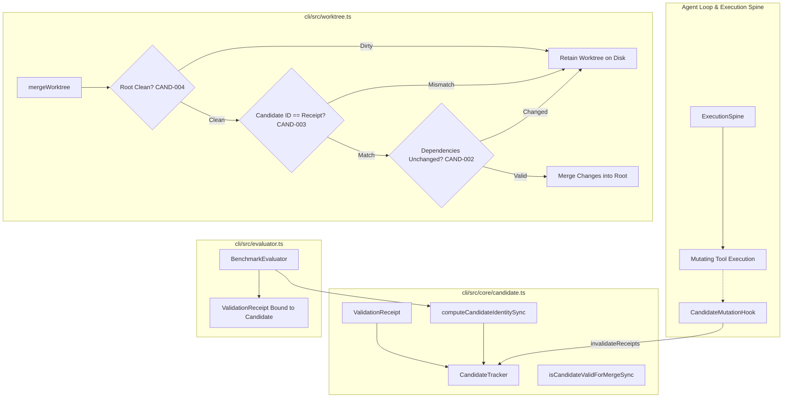

# Architecture Decision Record: DEC-02
# Candidate Identity & Validation Binding Design

- **Decision ID:** `DEC-02`
- **Title:** Candidate Identity & Validation Binding Design
- **Work Package:** `WP-04 — Candidate Identity & Validation Binding`
- **Increment:** `INC-05`
- **Status:** `RESOLVED (CORRECTED)`
- **Date:** 2026-10-01
- **Owning Component:** `cli/src/core/candidate.ts`, `cli/src/worktree.ts`, `cli/src/evaluator.ts`, `cli/src/agent.ts`

---

## 1. Context and Problem Statement

Nexus executes autonomous coding tasks in isolated environments (Git worktrees or non-Git workspaces). A fundamental reliability and security requirement is ensuring that candidate modifications submitted for merge or evaluation are precisely and authoritatively validated.

In earlier harness designs, validation was decoupled from candidate identity or tracked via simple boolean state (`verifiedWorktreeCompletion = true`):
1. **Mutation After Validation:** An agent could execute a verifier tool (e.g. `npm test`), achieve a passing exit code, and then subsequently mutate files—either intentionally or accidentally—before invoking `task_completed` or merging. The merged code would not be what was validated.
2. **Cross-Candidate Authorization Replay:** A validation receipt generated for candidate workspace $A$ could be replayed to authorize unverified candidate workspace $B$.
3. **Untracked File and Working-Tree Blind Spots:** Relying solely on `git commit` SHAs or git diffs against `HEAD` overlooks untracked files, unstaged modifications, or dirty working trees, permitting unverified code into production.
4. **Out-of-Band Modification Drift:** Changes made to a candidate worktree by background processes or external tools outside the agent's execution spine were not detected prior to merge.
5. **Material Dependency Drift:** Validations often depend on external dependencies, toolchains, or test configurations (e.g., `package.json`, test configs). Modifying these dependencies invalidated previous test results without revoking the candidate's validation status.
6. **Target Repository Pollution (`CAND-004`):** Merging into a dirty root repository overwrote uncommitted developer modifications and produced irreproducible states.
7. **Benchmark Evaluation Divergence (`F-02`, `VER-001`, `VER-005`):** In SWE-bench evaluations, diff generation evaluated the root repository rather than the candidate worktree, causing inaccurate evaluations.

`DEC-02` was formulated to establish a robust, tamper-evident candidate identity and validation binding architecture.

---

## 2. Decision Drivers and Evaluation Criteria

1. **Deterministic Cryptographic Identity (`CAND-001`):** Every candidate workspace must possess a stable, reproducible cryptographic identity (`candidateId`) capturing all tracked, unstaged, and untracked modifications, with fallback support for non-Git workspaces.
2. **Immediate Invalidation on Mutation (`CAND-002`):** Any candidate modification or material validation dependency change post-validation must immediately invalidate any active `ValidationReceipt`.
3. **Strict Identity Equality at Merge (`CAND-003`):** The worktree merge engine must independently recompute candidate identity from disk at merge time and fail closed if it does not strictly match the validated receipt.
4. **Target Repository Cleanliness & Worktree Retention (`CAND-004`):** Merge must be refused if the target repository contains uncommitted or unstaged changes, and the candidate worktree must be retained on merge refusal to prevent data loss.
5. **Benchmark Evaluator Candidate Worktree Binding (`F-02`, `VER-001`, `VER-005`):** SWE-bench evaluations must bind validation receipts directly to candidate worktrees rather than root repository diffs.
6. **Performance & Scalability:** Candidate identity computation must be fast (< 100ms) and avoid full-tree recursive hashing in Git repositories.
7. **Fail-Closed Semantics:** Any missing receipt, corrupted receipt, identity mismatch, or dependency hash discrepancy must result in merge refusal. Full-access modes must never bypass candidate validation binding.

---

## 3. Evaluated Alternatives

### Option A: Commit-Only SHA Identity
- **Mechanism:** Require candidate changes to be committed, using the Git commit SHA as the candidate identity.
- **Evaluation:**
  - Fails to capture dirty working trees, staged-but-uncommitted changes, and untracked files during active agent iteration.
  - Requires continuous throwaway commits during agent loops.
  - Cannot support non-Git workspaces.
- **Disposition:** **REJECTED**.

### Option B: Full-Tree Merkle Hashing
- **Mechanism:** Recursively hash every file and directory in the candidate workspace to compute a Merkle root hash.
- **Evaluation:**
  - Extremely high I/O overhead on large repositories containing dependencies (e.g. `node_modules`, Rust `target/`, Python virtual environments).
  - Computation times exceed several seconds, violating latency requirements.
- **Disposition:** **REJECTED**.

### Option C: Canonical Structural Content-Addressed Manifest with Dependency and Evaluator Binding (SELECTED & CORRECTED)
- **Mechanism:**
  1. **Git Workspaces:** Query `git status --porcelain=v1 --untracked-files=all` using pattern `/^([ MADRCUT?!]{2})\s+(.*)$/` capturing modifications (`M`), additions (`A`), deletions (`D`), renames (`R`), copies (`C`), unmerged (`U`), type changes (`T`), and untracked files (`??`).
  2. **Structural Attributes & Symlink Identity:** Inspect entries via `fs.lstatSync`. Record explicit structural mode (`"100644"` for non-executable file, `"100755"` for executable file, `"120000"` for symlink, `"000000"` for deleted). For symlinks, hash the target link text (`fs.readlinkSync`) rather than dereferenced file bytes. Sort paths canonically (`localeCompare`).
  3. **Non-Git Workspaces:** Perform deterministic recursive traversal excluding standard ephemeral folders (`.git`, `node_modules`, `.nexus`, `dist`, `target`). Explicitly discover and record symbolic links (`mode: "120000"`). Unsupported filesystem object types (e.g., FIFOs, sockets) fail closed.
  4. **Validation Receipts (`CAND-001`):** Model validation receipts containing `receiptId`, `candidateId`, `verifierCommand`, `exitCode`, `stdoutHash`, `status`, and declared `materialDependencies` (`name`, `path`, `versionOrHash`).
  5. **Immediate Mutation Invalidation (`CAND-002`):** Register `CandidateMutationHook` on `ExecutionSpine`. When a mutating capability completes, evaluate candidate workspace containment. Any successful mutation inside the workspace (including new file creation, replacement, or deletion) or touching declared material dependencies immediately transitions active receipts to `INVALIDATED`.
  6. **At-Merge Disk Re-verification (`CAND-003`):** In `mergeWorktree`, recompute candidate identity from disk. If the on-disk candidate identity or material dependency hashes differ from the receipt, refuse merge.
  7. **Root Cleanliness Gating (`CAND-004`):** Inspect target root with `git status --porcelain`. If dirty, refuse merge and retain the candidate worktree.
  8. **SWE-bench Evaluator Binding (`F-02`, `VER-001`, `VER-005`):** Compute candidate identity and issue `ValidationReceipt` directly within `BenchmarkEvaluator` against candidate workspaces.
- **Evaluation:**
  - Fast: only examines modified/untracked files (< 50ms typical).
  - Deterministic and collision-resistant (SHA-256).
  - Defeats out-of-band tampering, post-validation mutation, and structural type changes.
  - Guarantees target repository integrity.
- **Disposition:** **ACCEPTED AND IMPLEMENTED**.

---

## 4. Implementation Architecture

### 4.1 Component Diagram



### 4.2 Core Data Structures

- `FileCandidateEntry`:
  ```typescript
  export interface FileCandidateEntry {
    path: string;           // Relative POSIX path
    mode: string;           // "100644" | "100755" | "120000" | "000000"
    contentHash: string;    // SHA-256 hex
    size: number;
    status: CandidateFileStatus; // "modified" | "added" | "deleted" | "untracked" | "typechange"
  }
  ```
- `CandidateIdentity`:
  ```typescript
  export interface CandidateIdentity {
    candidateId: string;    // SHA-256 hex string
    workspacePath: string;
    rootBaseSha: string;
    trackedChanges: FileCandidateEntry[];
    untrackedFiles: FileCandidateEntry[];
    manifestHash: string;
    isGit: boolean;
    timestamp: string;
  }
  ```
- `ValidationReceipt`:
  ```typescript
  export interface ValidationReceipt {
    receiptId: string;
    candidateId: string;
    verifierCommand: string;
    exitCode: number;
    stdoutHash: string;
    status: "PASSED" | "FAILED" | "INVALIDATED";
    materialDependencies: MaterialValidationDependency[];
    evaluatorBinding?: EvaluatorBinding;
    invalidationReason?: string;
    timestamp: string;
  }
  ```

---

## 5. Empirical Verification & Test Evidence

Comprehensive tests in `cli/test/candidate.test.ts` and `cli/test/evaluator.test.ts` demonstrate compliance across 25 automated test cases:

1. **Determinism (`CAND-001`, Property A):** Unchanged candidates produce identical 64-character SHA-256 identities across invocations.
2. **Tracked & Unstaged Modifications (`CAND-001`, Properties B & C):** Editing files, staging changes, or creating unstaged edits immediately changes `candidateId`.
3. **Untracked File Inclusion (`CAND-001`, Property D):** Adding or mutating untracked files produces distinct candidate identities.
4. **Git-Ignored File Exclusion (Property E):** Adding build artifacts matched by `.gitignore` (e.g. `node_modules/`, `build.log`) does not alter candidate identity.
5. **Non-Git Workspace Support (Property F):** Manifest-based calculation produces stable identities and detects additions/modifications in non-Git directories.
6. **Dependency Invalidation (`CAND-002`, Property H):** Altering a declared material validation dependency (e.g., config file) marks validation receipts invalid at merge verification.
7. **Post-Validation Mutation Refusal (`CAND-002`, Property I):** Modifying a file after validation fails closed during merge attempt; worktree is preserved.
8. **Out-of-Band Mutation Detection (Property J):** File modifications applied outside the agent process are caught at merge time via on-disk re-computation.
9. **Cross-Candidate Replay Rejection (`CAND-003`, Property O):** Validation receipts generated for candidate A are refused when presented for candidate B.
10. **Target Repository Cleanliness (`CAND-004`):** Dirty root repository with uncommitted changes blocks candidate merge; worktree remains intact on disk.
11. **Full-Access Invariance (Property P):** Running with `--full-access` does not bypass validation receipt enforcement or candidate identity checks.
12. **SWE-bench Evaluator Candidate Binding (`F-02`, `VER-001`, `VER-005`):** Evaluator directly binds validation receipts to candidate worktree identities.
13. **Git Typechange Detection (`F-WP04-MAT-01`):** Replacing a regular file with a symlink or vice-versa is detected via Git porcelain status `T`, changing `candidateId`.
14. **Immediate Mutation Invalidation on New Files (`F-WP04-MAT-02`):** Creating an unseen new file post-validation transitions active receipts to `INVALIDATED`.
15. **Symlink Target Identity (`F-WP04-MIN-01`):** Changing symlink target text changes `candidateId`; symlinks and regular files remain structurally distinct.
16. **Executable Mode (`F-WP04-MIN-02`):** Executing `chmod +x` or `chmod -x` on content-modified files alters `candidateId` via mode bits.
17. **Non-Git Symlinks (`F-WP04-MIN-03`):** Non-git workspace manifests discover symlinks and detect link target alterations.
18. **Combined Adversarial Case:** Tracked content edit + typechange + validation + subsequent new file mutation fails closed.

All 25 test cases passed with zero failures.

---

## 6. Residual Considerations and Operating Envelope

- **Material Dependency Discovery Boundary:** `CandidateTracker` verifies declared `materialDependencies` against on-disk hashes at merge time. Automatic discovery of implicit project dependencies (e.g. compiler version, ambient test runner binaries) is not implemented in this increment; the validator/evaluator producer is responsible for declaring relevant material dependencies.
- **Evaluator Binding Gating (`F-WP04-OBS-01`):** `EvaluatorBinding` is recorded on receipts as audit metadata. In the current single-tenant runtime, merge gating checks candidate equality and receipt status, but does not enforce task-to-evaluator authorization mapping.
- **Verifier Output Hashing in Agent Loop (`F-WP04-OBS-02`):** `task_completed` records a static digest for `stdoutHash`. Benchmark evaluator records the real stdout hash.
- **Concurrency & TOCTOU Boundary (`F-WP04-OBS-03`):** Disk state is re-evaluated immediately before `git commit` in `mergeWorktree`. Under the present single-agent sequential execution model, concurrent writers are not active.
