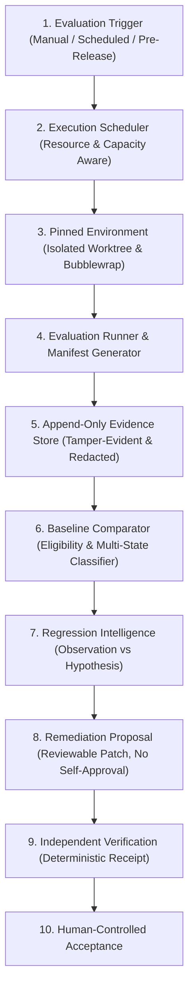

# Continuous Evaluation and Regression Intelligence (CERI) Architecture Assessment

**Document ID:** `NEXUS-ARCH-V112-CERI-ASSESSMENT`  
**Target Release:** Nexus Code `v1.1.2`  
**Author:** Principal Software Architect, Reliability Engineer, & Implementation Lead  
**Date:** 2026-11-01  
**Status:** Approved for Implementation Planning  

---

## 1. Executive Summary & Core Architectural Principle

As Nexus Code scales its multi-agent capabilities, specialist delegation, and micro-routing, continuous evaluation is essential to detect capability regressions before releases are cut. 

However, automated self-evaluation introduces severe epistemic risks: models can hallucinate correctness, rationalise shortcuts, overfit to static benchmarks, or experience confirmation bias when grading their own output or peer output.

### The Foundational CERI Axiom:
> **Internal evaluation results may veto a release or implementation, but must not independently establish correctness.**  
> Passing internal tests, agent confidence scores, or agreement between models are advisory signals and negative filters, never authoritative proof of independent validation.

True validation requires deterministic, tamper-evident execution receipts bound to reproducible candidate identities, evaluated against clean baselines, and verified by authoritative independent mechanisms or human operators.

---

## 2. Existing Repository Reconnaissance & Gap Analysis

An inspection of the existing codebase (`eval/`, `cli/src/evaluator.ts`, `cli/src/evidence.ts`, `cli/src/core/candidate.ts`, `cli/src/core/resources.ts`, and `cli/src/core/independent_review.ts`) reveals both powerful existing primitives and critical systemic gaps:

### 2.1 Reusable Components
1. **Candidate Identity & Receipts ([`cli/src/core/candidate.ts`](file:///home/mike/nexus-wt/v112-orchestration/cli/src/core/candidate.ts)):**
   - Implements `CandidateIdentity` (SHA-256 composite digest of `rootBaseSha` + canonical manifest).
   - Implements `ValidationReceipt` (binds `receiptId`, `candidateId`, `verifierCommand`, `exitCode`, `stdoutHash`, `status: "PASSED" | "FAILED" | "INVALIDATED"`).
   - Authoritative for candidate verification; must be preserved and reused directly.
2. **Hardened Evaluation Isolation ([`eval/isolate.mjs`](file:///home/mike/nexus-wt/v112-orchestration/eval/isolate.mjs)):**
   - Bubblewrap namespace isolation for evaluation tasks, blocking network access and separating private oracle files (`blackbox-v1` protocol).
3. **Model Proxy Telemetry ([`eval/model_proxy.mjs`](file:///home/mike/nexus-wt/v112-orchestration/eval/model_proxy.mjs)):**
   - Distinguishes infrastructure failures (e.g. 502/503 upstream gateway) from agent failures (`isInfrastructureFailure`).
4. **Secret Redaction & Evidence Safety ([`cli/src/evidence.ts`](file:///home/mike/nexus-wt/v112-orchestration/cli/src/evidence.ts)):**
   - Implements `redactSecrets`, `redactedJson`, and `safeDiffText` to prevent credential leakage into persisted logs.
5. **Specialist Profiles & Review Boundary ([`cli/src/core/specialist_profiles.ts`](file:///home/mike/nexus-wt/v112-orchestration/cli/src/core/specialist_profiles.ts), [`cli/src/core/independent_review.ts`](file:///home/mike/nexus-wt/v112-orchestration/cli/src/core/independent_review.ts)):**
   - Enforces tool whitelisting and narrative redaction in review prompts.

### 2.2 Systemic Gaps & Structural Vulnerabilities
1. **Lack of Versioned Evaluation Definitions:**
   - Existing SWE-bench tasks (`SweBenchInstance`) lack explicit metadata regarding capability domains, authorized tools, resource budgets, deterministic assertions, and declared non-deterministic behaviors.
2. **Missing Run Manifests & Provenance Tracking:**
   - Evaluator runs currently do not record the git commit SHA, dirty worktree status, exact model quantization/checkpoint digests, gateway routing configurations, or host hardware environments.
3. **Implicit & Fragile Baseline Comparison:**
   - Comparison currently assumes the previous run is authoritative or compares across runs with mismatched model configurations. There is no explicit baseline designation, comparability validation, or multi-state comparative classification.
4. **Binary Outcome Forcing:**
   - Existing evaluation categorizes outcomes strictly into `RESOLVED` / `UNRESOLVED` / `ERROR`. It fails to represent `REGRESSION_CANDIDATE`, `CONFIRMED_REGRESSION`, `FLAKY`, `INCONCLUSIVE`, or `INCOMPARABLE`.
5. **Absence of Regression Intelligence Boundary:**
   - When a regression occurs, there is no structured investigation protocol that separates hard observations from speculative LLM inferences or hypotheses.
6. **Risk of Remediation Self-Approval:**
   - Without explicit state barriers, an agent proposing an automated remediation patch could approve its own fix or weaken the evaluation acceptance threshold to force a pass.

---

## 3. Target CERI Pipeline Architecture

The logical CERI pipeline is designed to be modular and embedded within Nexus Code without introducing heavyweight external orchestration services:

---

## 4. Key Architectural Decisions

### DEC-CERI-01: Explicit Designated Baselines
Baselines must be explicitly declared and cryptographically verified. The system will reject comparisons if:
- The evaluation definition version has drifted.
- The model checkpoint or quantization parameters differ materially.
- The baseline was executed on an unrecorded dirty worktree.

### DEC-CERI-02: 12-State Comparative Classification
Outcomes will never be forced into a binary Pass/Fail. The classifier supports:
`PASS`, `FAIL`, `REGRESSION_CANDIDATE`, `CONFIRMED_REGRESSION`, `IMPROVEMENT_CANDIDATE`, `FLAKY`, `INFRASTRUCTURE_FAILURE`, `EVALUATOR_DEFECT`, `INCONCLUSIVE`, `NOT_EXECUTED`, `CANCELLED`, `INCOMPARABLE`.

### DEC-CERI-03: Separation of Tamper-Evidence from Independent Trust
A hash-chain generated by an evaluation runner proves only that logs have not been altered post-execution; it does not prove the model behaved correctly. Authoritative validation requires a deterministic `ValidationReceipt` produced by an external verifier or test execution pass.

### DEC-CERI-04: Structured Investigation Discipline
Investigation artifacts must strictly separate:
- `OBSERVATION`: Raw, incontrovertible evidence (exit code, diff, log line).
- `INFERENCE`: Logical deduction from observations.
- `HYPOTHESIS`: Plausible root cause requiring experimental confirmation.
- `CONFIRMED_FINDING`: Hypothesis validated through targeted reproduction.
- `UNRESOLVED_UNCERTAINTY`: Areas where evidence is incomplete or ambiguous.

### DEC-CERI-05: Non-Self-Approving Remediation Pathway
Agents generating remediation proposals must have `approvalStatus: "PENDING_REVIEW"`. Under no circumstances may the authoring agent approve its own proposal, and remediation changes to test definitions must be isolated in separate, independently reviewed commits.
